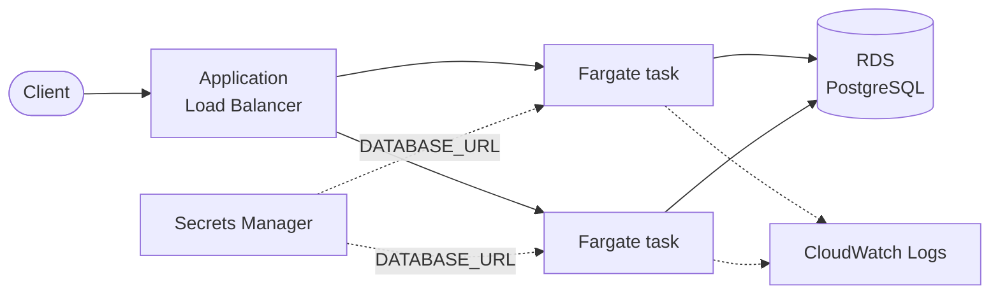

# fastapi-aws-ecs-fargate

A URL shortener built with FastAPI and deployed on AWS ECS Fargate. Docker containerization, ECR integration, and infrastructure as code with Terraform.

The application itself is deliberately small. The point of the repository is everything around it: how a container reaches production on AWS, and how the code stays independent of the place it runs.

## The API

| Method | Path           | Description                                    |
| ------ | -------------- | ---------------------------------------------- |
| `POST` | `/links`       | Shortens a URL and returns its code             |
| `GET`  | `/{code}`      | Redirects to the target and records the visit   |
| `GET`  | `/links/{code}`| Returns the target URL and the visit count      |
| `GET`  | `/health`      | Liveness probe used by the load balancer        |

Interactive documentation is served at `/docs`.

## Architecture



The load balancer is the only component reachable from the internet. Tasks accept traffic from its security group alone, and the database accepts traffic only from the tasks.

## How the code is organised

```
src/shortener/
├── domain/           Entities, the repository interface, and the use cases
├── infrastructure/   SQLAlchemy implementation of that interface
├── api/              FastAPI routes, schemas, and dependency wiring
└── main.py           Application factory
```

`domain/` does not import SQLAlchemy. It declares the `LinkRepository` protocol it needs and receives an implementation through the constructor, so the same use cases run against PostgreSQL in production and SQLite in the test suite. Swapping the storage engine is a matter of writing one class.

## Running it locally

```bash
docker compose up --build
```

The API listens on <http://localhost:8000> with a PostgreSQL container behind it. Set `API_PORT` and `BASE_URL` to use a different port:

```bash
API_PORT=8080 BASE_URL=http://localhost:8080 docker compose up --build
```

A quick check:

```bash
curl -X POST http://localhost:8000/links -H 'Content-Type: application/json' -d '{"target_url":"https://fastapi.tiangolo.com"}'
```

## Running the tests

```bash
docker compose --profile test run --rm tests
```

The suite covers the happy path end to end — shorten, redirect, count — against SQLite, so it needs no running database.

## Deploying to AWS

Requires AWS credentials with permission to create VPC, ECS, RDS, ALB, ECR, IAM, and Secrets Manager resources.

**1. Create the registry first.** The task definition references an image that must already exist.

```bash
cd infra
cp terraform.tfvars.example terraform.tfvars
terraform init
terraform apply -target=aws_ecr_repository.app
```

**2. Build and push the image.**

```bash
aws ecr get-login-password --region us-east-1 | docker login --username AWS --password-stdin "$(terraform output -raw ecr_repository_url | cut -d/ -f1)"
docker build --target runtime -t "$(terraform output -raw ecr_repository_url):latest" ..
docker push "$(terraform output -raw ecr_repository_url):latest"
```

**3. Create the rest of the infrastructure.**

```bash
terraform apply
```

`terraform output service_url` prints the public address once the service is stable.

To deploy a new version, push a new tag and apply with `-var="image_tag=<tag>"`. The service uses a deployment circuit breaker, so a task that fails its health check rolls back automatically.

### Tearing it down

```bash
terraform destroy
```

RDS, the NAT-free public subnets, and the load balancer all bill by the hour. Destroy the stack when you are done experimenting.

## Deliberate simplifications

These are choices, not oversights. Each one is what a real deployment would change first.

- **Tasks run in public subnets** with a public IP, restricted by security group. Private subnets would be stricter but require a NAT Gateway, which costs more than everything else here combined.
- **The schema is created at startup** by SQLAlchemy. A service with more than one table belongs behind Alembic migrations run as a separate task.
- **The listener is plain HTTP.** HTTPS needs a domain and an ACM certificate, neither of which belongs in a template.
- **`skip_final_snapshot` is enabled** on RDS so the stack can be destroyed cleanly.

## License

MIT — see [LICENSE](LICENSE).
